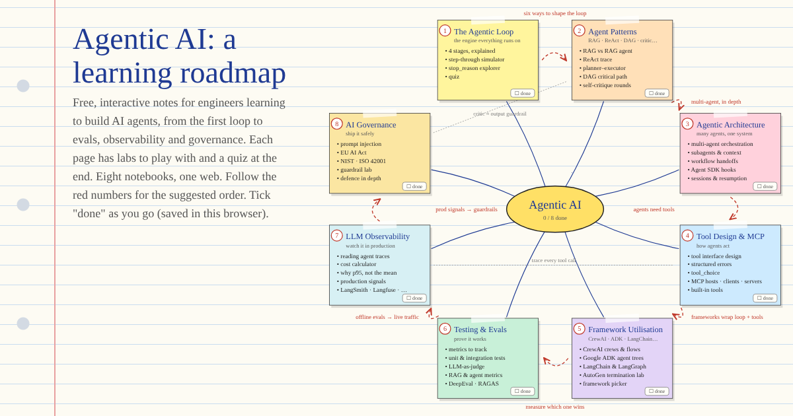

# Agentic AI notebook

Free, interactive, notebook-style pages for engineers learning to build AI agents.
Each page explains one topic with diagrams, hands-on labs and a quiz at the end.

**Start here:** https://devlcodes.github.io/agentic-ai-notebook/

## Topics

Follow them in order, or jump to whatever you need.

1. [The Agentic Loop](https://devlcodes.github.io/agentic-ai-notebook/agentic-loop.html): perceive, reason, act, observe, with a step-through simulator
2. [Agent Patterns](https://devlcodes.github.io/agentic-ai-notebook/agent-patterns.html): RAG agents, ReAct, planner–executor, DAGs, multi-agent, self-critique
3. [Agentic Architecture](https://devlcodes.github.io/agentic-ai-notebook/agentic-architecture.html): orchestration, subagent context, deterministic gates, hooks, sessions
4. [Tool Design & MCP](https://devlcodes.github.io/agentic-ai-notebook/tool-design-mcp.html): tool descriptions, structured errors, `tool_choice`, MCP servers
5. [Framework Utilisation](https://devlcodes.github.io/agentic-ai-notebook/frameworks.html): CrewAI, Google ADK, LangGraph, LlamaIndex, Semantic Kernel, AutoGen
6. [Testing & Evals](https://devlcodes.github.io/agentic-ai-notebook/testing-and-evals.html): unit and trajectory tests, LLM-as-judge, RAG metrics, DeepEval, RAGAS
7. [LLM Observability](https://devlcodes.github.io/agentic-ai-notebook/llm-observability.html): OpenTelemetry traces, cost and latency, production signals
8. [AI Governance](https://devlcodes.github.io/agentic-ai-notebook/ai-governance.html): prompt injection, OWASP LLM Top 10, EU AI Act, NIST, guardrails

Coming next: retrieval, agent memory, production, and the model layer.

## System design walkthroughs

Worked designs that combine the topics above, in [`system-design/`](system-design/): **https://devlcodes.github.io/agentic-ai-notebook/system-design/**

- [Enterprise Search Assistant](https://devlcodes.github.io/agentic-ai-notebook/system-design/enterprise-search.html): RAG over 10M documents in Drive, Confluence and Jira, with an animated 3D architecture
- Topic deep dives: [knowledge base](https://devlcodes.github.io/agentic-ai-notebook/system-design/knowledge-base.html), [backfills and re-indexing](https://devlcodes.github.io/agentic-ai-notebook/system-design/backfills.html), [embeddings](https://devlcodes.github.io/agentic-ai-notebook/system-design/embeddings.html), [vector databases](https://devlcodes.github.io/agentic-ai-notebook/system-design/vector-databases.html), [search types](https://devlcodes.github.io/agentic-ai-notebook/system-design/search-types.html), [reranking](https://devlcodes.github.io/agentic-ai-notebook/system-design/reranking.html), [access control](https://devlcodes.github.io/agentic-ai-notebook/system-design/access-control.html)
- [Glossary](https://devlcodes.github.io/agentic-ai-notebook/system-design/glossary.html): every term in one line

These pages are also single HTML files with inline CSS. The Enterprise Search animation loads Three.js from a CDN, so it needs a connection; everything else works offline.

## How it's built

Each page is a single HTML file with inline CSS and JavaScript: no build step, no dependencies, and it works offline.
To run it locally, open `index.html` in a browser. Progress ("done" ticks) is saved in your browser only.

Library APIs change fast. Code snippets show each API's shape as of 2026, so check the current docs before copying one.
